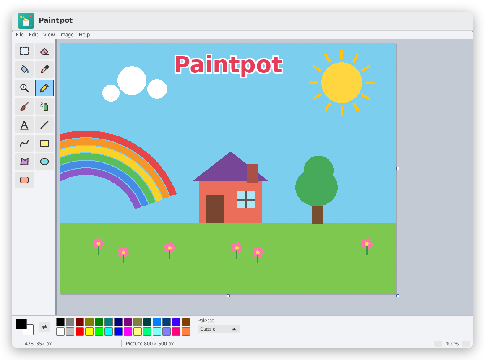

# Paintpot

A fast, friendly, **pixel-perfect** paint program in the spirit of classic (XP-era) MS Paint,
for Windows and Linux. It is a true pixel editor: what you draw is pixels, immediately.
There are no vector objects, no layers to manage, and no antialiasing smudging your edges,
so the paint bucket always does exactly what a child expects.

*"Paintpot" is a working name; see [Naming](#naming).*



## Features

- **Tools** (classic toolbox order): Select, Eraser / Color eraser, Fill, Pick color,
  Magnifier, Pencil, Brush (round/square, any size), Airbrush, Text, Line, Curve (2-bend
  Bezier, as in Paint), Rectangle, Polygon, Ellipse, Rounded rectangle.
- **Left button = primary color, right button = secondary color** on every tool.
- Shapes: outline / outline + fill / solid, line widths 1 to 12, Shift for square/circle/45°.
- "From center" mode for ellipses and rectangles: click the centre, drag the radius, for
  perfectly centred circles (odd sizes, symmetric). Alt flips the mode while dragging.
- Text: any installed font, size, bold/italic, transparent or opaque background. Text is
  aliased like everything else, so letters can be bucket-filled cleanly.
- **Fill**: 4-connected scanline flood fill, exact match by default, with an optional
  tolerance slider (for photos/JPEGs) and an "Everywhere" mode that replaces a color
  throughout the picture.
- Selection: move, Ctrl+drag to copy, transparent mode (secondary color is see-through),
  Delete, Cut/Copy/Paste through the system clipboard (pasting to/from other apps works),
  Crop to selection.
- Image: flip, rotate 90/180, invert colors, stretch (nearest-neighbour), canvas size,
  drag handles on the canvas edge to resize, clear image.
- **Shrinking the canvas never destroys pixels.** Pixels cut off by making the picture smaller
  are kept hidden; make it bigger again and they come back (shown faded while you drag).
  Tools, fill and saving only ever see the visible picture. Hidden pixels are frozen as they
  were, and are dropped by flip, rotate, stretch, crop, New and Open.
- Zoom from 12.5% to 3200%, pixel grid at high zoom, Ctrl+wheel zoom around the cursor,
  middle-drag to pan.
- Undo/redo (500 steps; only the changed rectangle is stored, so it's cheap).
- Open PNG, BMP, JPEG, GIF, TIFF, WebP, ICO; save PNG, BMP, JPEG, GIF, TIFF, WebP.
  Drag a file onto the window to open it, or pass it on the command line.
- Unsaved-changes prompt on New/Open/Exit.

## Design notes

**Why no antialiasing (and why the fill is reliable).** Every primitive writes whole pixels
of a single color. Lines are Bresenham (8-connected), and filled/outlined shapes are built
from per-row spans whose outline is "every inside pixel that touches the outside". The
flood fill is 4-connected. Together that gives a guarantee: **a fill started inside a closed
shape can never leak out**, and it never leaves a ring of half-blended pixels behind.
`src/raster.rs` has tests that draw thousands of ellipses, rectangles, rounded rectangles,
lines and curves at every size from 1x1 to 40x40 and assert that the fill stays inside.

My suggestion on antialiasing: keep the canvas aliased, always. If smooth edges are wanted
later, add them as an opt-in *per-shape* "Smooth" toggle (off by default) and pair it with the
fill tolerance slider, which already exists for exactly that case (filling a picture that
came in with soft edges, e.g. a JPEG or a screenshot).

**Why Rust + egui (not GTK, not Python, not C).**
- Rust compiles to a single native executable, is as fast as C, and its memory safety makes
  a canvas full of index arithmetic much less scary.
- egui/eframe draws the whole UI on the GPU and builds with nothing but `cargo` on both
  Windows and Linux. GTK4 on Windows means shipping the GTK runtime, which is painful.
- The UI library only *displays* the picture: the canvas is our own `Vec` of pixels, uploaded
  as a texture (only the changed rectangle each frame). All drawing is our own code, so it is
  exact and fast.
- Python would be too slow for flood fills on large pictures without a C extension, which is
  where you started.

**Code layout**

| File | What it does |
|---|---|
| `src/canvas.rs` | `Image` pixel buffer, `IRect`, blit/crop/rotate/flip/stretch |
| `src/raster.rs` | Brushes, Bresenham, shapes, polygon fill, Bezier, flood fill, airbrush (+ tests) |
| `src/doc.rs` | The document and region-based undo/redo (+ tests) |
| `src/tools.rs` | Tool list, shortcuts, hints, SVG icons |
| `src/text.rs` | System fonts (fontdb) and aliased text rendering (ab_glyph) |
| `src/app.rs` | UI: menus, toolbox, color box, canvas view, input, dialogs |
| `src/io.rs` | Load/save via the `image` crate |

## Keyboard

| Key | Action |
|---|---|
| S E F I Z P B A T L C R G O U | Select, Eraser, Fill, Pick color, Magnifier, Pencil, Brush, Airbrush, Text, Line, Curve, Rectangle, Polygon (G), Ellipse (O), Rounded rect (U) |
| X | Swap primary/secondary colors |
| Ctrl+Z / Ctrl+Y (Ctrl+Shift+Z) | Undo / redo |
| Ctrl+N / O / S, Ctrl+Shift+S | New, Open, Save, Save as |
| Ctrl+A, Del, Esc | Select all, delete selection, deselect / cancel |
| Ctrl+X / C / V | Cut / copy / paste |
| Ctrl+Shift+X | Crop to selection |
| Ctrl+E / Ctrl+W | Canvas size / Stretch |
| Ctrl+I | Invert colors |
| Ctrl+Shift+N | Clear image |
| Ctrl+ +/- / 0, Ctrl+wheel | Zoom in/out / actual size |
| Ctrl+G | Pixel grid |
| Enter | Finish polygon / curve |

## Building

You need Rust (https://rustup.rs).

```sh
cargo run --release
cargo test
```

**Windows:** use the default MSVC toolchain (Visual Studio Build Tools with the C++ workload).
The minimal `x86_64-pc-windows-gnu` toolchain on its own is not enough: it lacks the
assembler that `dlltool` needs. Keep the project in a short path (e.g. `C:\src\paintpot`);
some dependency build scripts exceed Windows' 260-character path limit otherwise.

**Linux (Debian/Ubuntu):**

```sh
sudo apt install build-essential libxkbcommon-dev libxcb-render0-dev libxcb-shape0-dev libxcb-xfixes0-dev libwayland-dev
cargo run --release
```

File dialogs use the XDG desktop portal (works on GNOME, KDE and most desktops).

**Arch Linux:**

A [`PKGBUILD`](PKGBUILD) is included in this repo. To build and install a package from source:

```sh
curl -LO https://raw.githubusercontent.com/marktbaldridge/paintpot/main/PKGBUILD
makepkg -si
```

This pulls a tagged release tarball, builds it with `cargo`, runs the test suite, and
installs `paintpot` via `pacman`. Only `cargo` is needed to build; everything else
(`libxkbcommon`, Wayland/X11, Mesa, `xdg-desktop-portal`) is a normal runtime dependency
already present on most desktop installs. No AUR package yet — this is the first step
toward one.

## Roadmap ideas

- Free-form selection; moving the caret inside text being typed
- Stretch/skew a selection, resize selection by its handles
- Remember custom palette colors and window settings between runs
- Tiled canvas textures for pictures larger than 8192 px
- Optional per-shape smoothing (off by default; see design notes)
- Packaging: MSI/winget for Windows, Flatpak/AppImage for Linux

## Naming

"OpenPaint", "NeoPaint", "TuxPaint", "KolourPaint", "Pinta" and "mtPaint" are taken. Some
candidates, none checked for trademarks or existing projects yet:

- **Paintpot**: friendly, says "paint" plainly, easy for kids to say
- **Daub**: short and distinctive (to daub = to smear paint)
- **Crayonbox**: instantly reads as "for kids"
- **Splotch**: playful
- **Pixie Paint**: hints at pixels, playful
- **Doodlebox**
